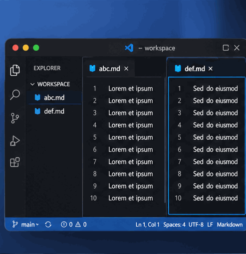

# Unique Editor Groups

**Open a file. Keep its place.**

Tired of the same file popping up in multiple VS Code editor groups?

**Unique Editor Groups** keeps each file in the editor group where it's already open. Click it in the Explorer, and VS Code takes you straight back to its existing editor.

## Features

- **No duplicate editors** — Return to the editor group already displaying the file.
- **Unsaved-work safe** — Never closes a duplicate containing unsaved changes.
- **One-click toggle** — Enable or disable protection directly from the status bar.

## Settings

| Setting | Default | Description |
|---|---|---|
| `uniqueEditorGroups.enabled` | `true` | Enable duplicate-editor protection. |
| `uniqueEditorGroups.warnOnDirtyDuplicate` | `true` | Warn when a duplicate has unsaved changes. |

Click **Unique Groups: On/Off** in the status bar to toggle protection.

---

**Less tab clutter. More focus.**
